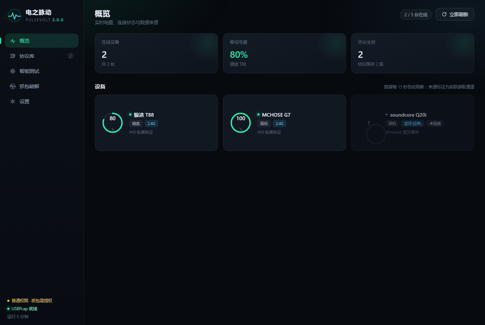
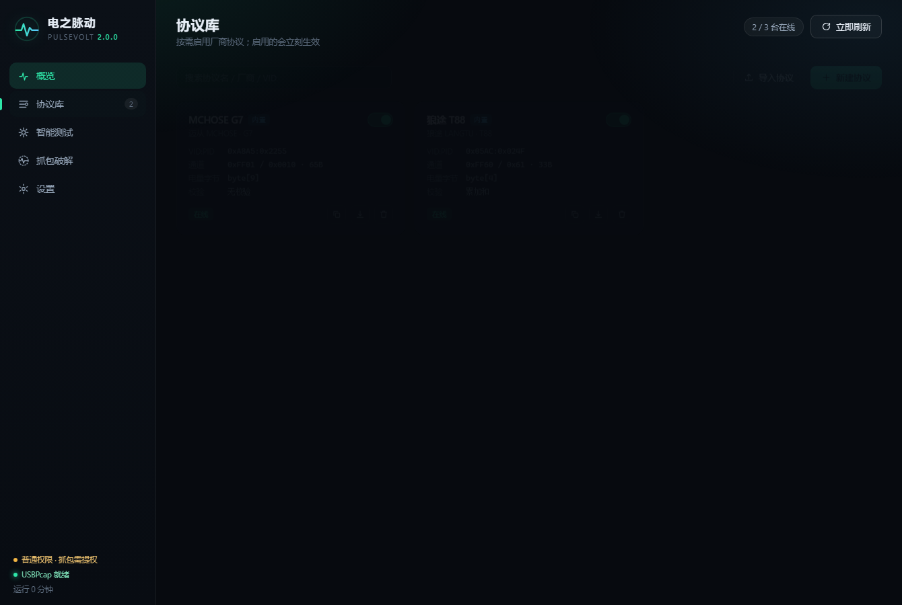
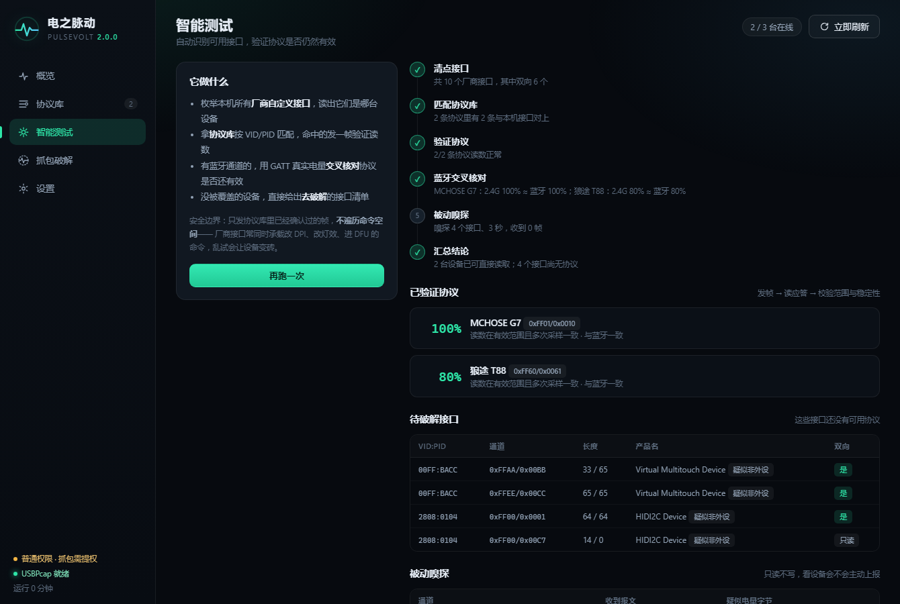
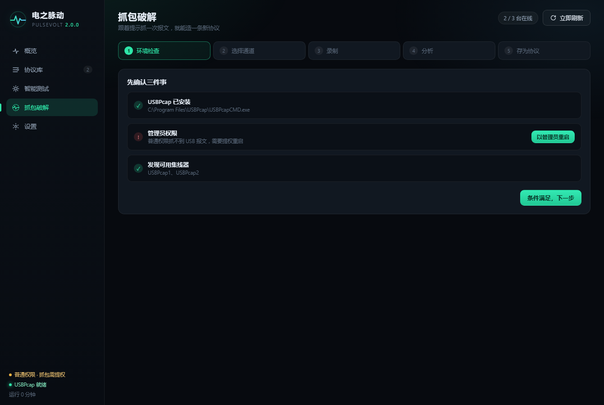

# 电之脉动 · 新手教程（零基础版）

> **一句话**：装上它，以后鼠标、键盘、耳机还剩多少电，看一眼任务栏右下角就知道，不用再猜「是不是该充电了」。

这份教程假设你**完全不懂编程**，也没用过命令行。按顺序做就行，每一步都写了「你会看到什么」。

---

## 目录

1. [这东西能干什么](#一这东西能干什么)
2. [下载与第一次打开](#二下载与第一次打开)
3. [托盘图标在哪](#三托盘图标在哪这一节很关键)
4. [界面导览：五个页签分别是干什么的](#四界面导览五个页签分别是干什么的)
5. [确认自己的设备有没有被认出来](#五确认自己的设备有没有被认出来)
6. [读不出电量怎么办](#六读不出电量怎么办三步排查)
7. [进阶：给自己的设备「造」一条协议](#七进阶给自己的设备造一条协议)
8. [协议是什么能不能给朋友用](#八协议是什么能不能给朋友用)
9. [设置页每一项是什么意思](#九设置页每一项是什么意思)
10. [常见问题](#十常见问题)
11. [安全提醒](#十一安全提醒)

---

## 一、这东西能干什么

先说清楚**能做到**和**做不到**，免得你白折腾。

**能做到**：

- 鼠标、键盘、手柄、耳机，**还剩百分之多少电**，一目了然
- 不管是插着那个小 USB 接收器（2.4G），还是用蓝牙连着，都支持
- 电量太低会弹提示（默认低于 20% 提醒一次）
- 不认识的新设备，可以**自己动手把它变成能读的**

**做不到**（很重要，别抱错期待）：

- ❌ 不是所有设备都能读。**蓝牙设备基本都能读**（系统本身有标准），**2.4G 设备要一家一家破解**
- ❌ 读不出来的设备，它不会编一个假数字给你，只会老老实实显示 `未知`
- ❌ 不能给设备充电，也不能提高续航 😄

**几个词先解释一下**，后面会一直用到：

| 词 | 大白话 |
|---|---|
| **蓝牙** | 一种无线连法，电脑自带，不用插东西 |
| **2.4G** | 就是那个**插在电脑 USB 口上的小方块**（接收器），鼠标键盘靠它连电脑 |
| **协议** | 电脑和接收器之间的「暗号」。厂商各用各的，所以我们得一家一家搞清楚 |
| **抓包** | 把电脑和接收器之间的对话**录下来**，照着抄，就能搞懂暗号 |

---

## 二、下载与第一次打开

### 第 1 步：下载

打开这个页面：

```
https://github.com/yangyuan130130/pulsevolt/releases/latest
```

在页面最下面找到 **`PulseVolt.exe`**，点它下载（大约 28 MB）。

> 💡 打不开这个网址？说明你的网络访问 GitHub 有问题，需要先解决网络（这一步本教程没法替你搞定）。

### 第 2 步：放到一个不会被误删的地方

下载完的文件在「下载」文件夹里。**不要放在桌面上**（容易被当垃圾清掉）。

建议：

1. 在 D 盘新建一个文件夹，叫 `工具`
2. 在 `工具` 里再建一个文件夹，叫 `电之脉动`
3. 把 `PulseVolt.exe` 拖进去

> ✅ 这个程序是**绿色免安装**的，不用点「下一步」、不会写注册表、不会开机自动启动（除非你自己去设置里打开）。想删的时候直接删文件夹就行。

### 第 3 步：双击打开

双击 `PulseVolt.exe`。

**第一次打开要等 2～4 秒**（程序要先把自己解压到临时目录），这段时间没反应是正常的，别急着连点。

然后你会看到**两样东西**：

1. 一个黑底的窗口（就是操作界面）
2. 任务栏右下角，时间旁边**多了一个绿色电池小图标**

---

### ⚠️ 打开时可能遇到的两个提示

#### 提示一：「Windows 已保护你的电脑」

这是 **SmartScreen**，Windows 对所有「没花钱买签名证书」的程序都会这么说，不代表有毒。

**怎么处理**：

1. 点这句话下面的 **「更多信息」**（很小的一行字，容易看不见）
2. 点右下角出现的 **「仍要运行」**

#### 提示二：杀毒软件报毒

火绒、360、Windows Defender 可能把它删掉或隔离。

**为什么会这样**：这个程序会做两件在杀软眼里很「敏感」的事——读取 USB 设备的通信、把程序解压到临时目录运行。很多正常工具都因为这个被误报。

**怎么处理**：

1. 在杀软的「隔离区」里找到 `PulseVolt.exe`，选**恢复**
2. 把它**加入信任区 / 白名单**（火绒：安全设置 → 信任区 → 添加文件）

> ⚠️ 如果你不放心，可以**从源码自己构建**（仓库里有 `build.bat`），或者干脆不用。不放心就别装，这很正常。

---

## 三、托盘图标在哪（这一节很关键）

程序的核心其实在**任务栏右下角那个电池图标**上。

### 3.1 可能「看不见」图标

Windows 11 有个「隐藏的图标」区域（任务栏右边那个 **`^`** 小箭头）。**新装程序的图标默认是藏起来的**，这是系统的设定，不是程序坏了。

**怎么让它常驻显示**：

1. 点任务栏右边的 **`^`**（向上箭头）
2. 看到那个绿色电池图标，**按住它往任务栏方向拖**
3. 拖到任务栏上松手，以后就一直显示了

### 3.2 图标上的数字是什么意思

- 图标本身是**电量最低的那台设备**的百分比
- 颜色：**绿色**＝电还多，**黄色**＝中等，**红色**＝快没电了
- 右键点它，会弹出一个菜单：

| 菜单项 | 作用 |
|---|---|
| 打开控制台 | 把刚才那个窗口重新叫出来 |
| 立即刷新 | 手动读一次，不用等 15 秒 |
| 退出 | **真正关掉程序** |

### 3.3 关掉窗口 ≠ 关掉程序

这是最容易搞混的一点：

> **点窗口右上角的 × 只是把窗口关了，程序还在后台跑**（因为托盘图标还在，电量还在更新）。

**想彻底退出**：右键托盘图标 → **退出**。

---

## 四、界面导览：五个页签分别是干什么的

左边那一列是页签，点一下就切换。

### 4.1 概览 —— 平时最常看的一页



**上面三个数字**：

- **在线设备**：现在有几台连着
- **最低电量**：所有设备里最少的那个，下面写着是哪台
- **协议生效**：有几个「暗号」正在用

**下面一排卡片**，每台设备一张：

| 你会看到 | 意思 |
|---|---|
| 一个圆环 + 数字 | 电量百分比，圆环转满了就是满电 |
| 「键盘」「鼠标」「耳机」 | 设备类型 |
| 「2.4G」「蓝牙」 | 现在是用哪种方式连着 |
| 「已连接」/「未连接」 | 现在连没连上 |
| 最下面一行小字 | **这个数字是从哪读来的**（比如「HID 私有协议」「Windows 蓝牙缓存」） |

> 💡 圆圈里显示 **`?`** 的那种，就是「这台设备读不出电量」。常见于老式蓝牙耳机——它的通信协议里**根本没有电量这一项**，不是程序的问题。

### 4.2 协议库 —— 「暗号」仓库



每一张卡片就是一个「暗号」。卡片右上角有个**开关**：

- 开关**打开** → 这个协议生效，对应设备就能读电量
- 开关**关闭** → 停用，设备会从概览里消失

卡片上几个关键信息：

| 字段 | 意思 |
|---|---|
| **VID:PID** | 设备的「身份证号」，每款设备都不一样 |
| **通道** | 用哪条通道说话 |
| **电量字节** | 电量藏在这句话的第几个字（`byte[4]` 就是第 4 个） |
| **校验** | 这句话末尾有没有「验证码」，防止说错 |

右上角的**导入协议**和**新建协议**按钮，见 [第八章](#八协议是什么能不能给朋友用)。

### 4.3 智能测试 —— 一键体检



点左边那个 **「开始智能测试」** 按钮，它会自动做六件事，右边一条条显示进度：

| 步骤 | 在干什么 |
|---|---|
| 清点接口 | 找出电脑上所有可以说话的设备通道 |
| 匹配协议库 | 看看哪些通道已经有暗号了 |
| 验证协议 | 对有暗号的设备发一句话，看回不回、回得对不对 |
| 蓝牙交叉核对 | **拿蓝牙读到的真数字，核对 2.4G 读到的是否一致** |
| 被动嗅探 | 只听不说，看设备会不会主动说话 |
| 汇总结论 | 告诉你几台能读、几台还不能 |

**最有价值的是第 4 步**。同一台鼠标如果蓝牙和 2.4G 都连着，它会拿蓝牙的真实电量去校对 2.4G 的读数：

- 显示「**与蓝牙一致**」→ 说明这个协议是好的，放心用
- 显示「相差 N」→ 说明协议可能因为换了固件失效了

> 💡 这就像「用另一把尺子量一遍」，比只看一个数字可靠得多。

### 4.4 抓包破解 —— 给不认识的设备造暗号



五步向导。**只有前面都失败了才需要用**，详见 [第七章](#七进阶给自己的设备造一条协议)。

### 4.5 设置 —— 改刷新频率、开机自启等

见 [第九章](#九设置页每一项是什么意思)。

---

## 五、确认自己的设备有没有被认出来

### 情况 A：蓝牙设备 → 一般不用管

只要**配对过**（在 Windows 设置 → 蓝牙里配过对），打开程序就会自动出现在概览里。

> 如果配对过但没出现，多半是它现在**没连上**。连上它，等 15 秒就会出来。

### 情况 B：2.4G 设备（插着小接收器）→ 去协议库打开开关

1. 去「协议库」页
2. 找找有没有你的设备（看名字或 VID:PID）
3. 有 → 把开关**打开**
4. 回「概览」，等 15 秒，看它有没有出现

目前内置了两种设备的协议（狼途 T88、迈从 G7）。**没有你的型号是正常的**——全世界鼠标键盘厂家那么多，不可能都收录。

没有的话，往下看第六章。

### 情况 C：什么都有但就是没我的 → 三条路

1. 先跑一次「智能测试」，看「待破解接口」里有没有你的设备
2. 去 [第七章](#七进阶给自己的设备造一条协议) 自己抓包造一条
3. 或者去 [Issues](https://github.com/yangyuan130130/pulsevolt/issues) 提需求（如果你会用 GitHub）

---

## 六、读不出电量怎么办（三步排查）

按顺序检查，**别跳步**。

### 第 1 步：它真的连上了吗？

- 蓝牙设备：Windows 设置 → 蓝牙和设备 → 看是不是「已连接」
- 2.4G 设备：把那个小接收器**换个 USB 口**试试（有些口接触不良），然后敲几下键盘/动几下鼠标，确认能用

> ⚠️ 一个常见误会：**键盘切到蓝牙后，2.4G 就读不到了**。反过来也一样。它现在用哪条路连，程序就只能从哪条路读。

### 第 2 步：协议打开了吗？

去「协议库」页，确认对应设备的开关是**打开的**（绿色）。

> 💡 开关打开但设备还是没出现？看卡片左下角：显示「**在线**」说明检测到了，显示「**未检测到**」说明设备不在那条路上。

### 第 3 步：还是没有 → 需要抓包

说明这个设备用的是「没人告诉过我们」的暗号。去第七章。

---

## 七、进阶：给自己的设备造一条协议

这一章稍微硬核，但**照做就行**，不需要懂代码。

### 7.1 什么时候需要做这个

只有这种情况：**设备连着、协议库也有、但读不出电量**。

如果设备根本读不出来，先回头确认第六步的前两关。

### 7.2 先准备两样东西

1. **USBPcap**（一个免费的小工具，用来录制 USB 对话）
   下载安装：[USBPcap 官网](https://desowin.org/usbpcap/) → 一路「下一步」即可
2. **厂商自己的驱动软件**（如果有的话）
   比如狼途的 `DeviceDriver.exe`、迈从的 `MCHOSE HUB`。**没有也能做，有会更省事**

> 💡 装 USBPcap 不需要现在重启电脑，装完回到本程序，去「抓包破解」页刷新一下就行。

### 7.3 五步操作

#### 步骤 ① 环境检查

点左边「抓包破解」。三项检查：

| 显示 | 意思 | 怎么办 |
|---|---|---|
| ✅ USBPcap 已安装 | 好了 | — |
| ❌ 管理员权限 | 抓 USB 必须管理员 | 点旁边的 **「以管理员重启」**，弹窗点「是」 |
| ✅ 发现可用集线器 | 有设备可抓 | — |

> ⚠️ **提权重启后，程序会重新打开一个窗口**，原来的窗口可以关掉。协议库和设置都还在，不会丢。

#### 步骤 ② 选择通道

勾上列出的集线器（`USBPcap1`、`USBPcap2`……）。

**不确定就全勾上**——多勾一个只是多录一个文件，不会出错。

录制时长选 **60 秒**（默认）。

点「**开始录制**」。

#### 步骤 ③ 录制（这一步最关键）

点完之后，**立刻去做这件事**：

> **把厂商驱动软件打开，或者在里面点一下「刷新设备」。**

为什么？因为**电量通常只在「打开设备」的那一瞬间问一次**，之后就不再问了。你不去操作它，就录不到。

界面上会显示计时器和已录到的数据量。60 秒后自动停止。

> ⚠️ 录的时候**不要**去点「停止」，让它自己跑完。中途停掉可能刚好错过那一句。

#### 步骤 ④ 分析

停录后自动跳到这一步。你会看到一张表，每行是**一次问答**：

| 列 | 意思 |
|---|---|
| 设备 | `dev=2 狼途 T88` 这样，`dev` 是系统给设备编的号 |
| 端点 | 用哪条小通道 |
| 长度 | 这句话多少字节 |
| 请求（前 8 字节） | 电脑问的那句话的开头 |

**怎么挑**：找到你设备那一行，**点一下**。下面会显示完整的「请求」和「应答」。

> 💡 挑不准就多试几行，看哪一行的应答里有一串数字「看起来像电量」。

#### 步骤 ⑤ 定位电量字节

这是最后一步，也最需要动脑。

1. 看一眼**厂商软件上显示的电量**（比如 68%）
2. 把它填进「此刻的真实电量」，点「**定位**」
3. 下面一排小方块会亮起来——**绿色那个就是电量所在的位置**
4. 点它，上面的「电量所在下标」会自动填好
5. 给协议起个名字（比如「罗技 G304」），点「**保存到协议库**」

保存后会自动启用，回「概览」等 15 秒就能看到读数。

### 7.4 三个必须知道的坑

#### 坑一：填的电量差 1% 就找不到

电量是估算出来的，会上下抖 1～2%。如果填 68 没找到绿色的，**试试点黄色的方块**（那些是 1~100 之间的数字，都可能）。

#### 坑二：报告 ID 那一位

程序已经替你处理了，但你要知道有这回事：

> 你看到的「下标 3」保存时会自动变成 4。因为真正读设备时，前面会多一个字节。**如果你手动填协议，记得 +1。**

#### 坑三：选错帧等于白忙

如果你选的那一行是「查询固件版本」之类的，它也会返回一串数字，看起来很像电量，其实不是。**唯一的判断标准：填进去的真实电量能不能对上。**

---

## 八、协议是什么？能不能给朋友用？

### 8.1 协议就是一份「说明书」

把它想成一张卡片，上面写着：

- 这个设备的身份证号是多少（VID:PID）
- 用哪条通道说话
- 说什么话它会回答电量
- 电量在回答的第几个字

**它只是一份文字说明，不是程序，不会跑起来，也没法害人。**

### 8.2 导出给别人

在「协议库」里，点卡片上的**向下箭头图标**（导出），会下载一个 `.json` 文件。发给朋友就行。

### 8.3 导入别人给的

点右上角「**导入协议**」→ 选文件（或把内容粘进去）→ 点「导入」。

> ✅ 导入**不会覆盖**你已有的协议，同名会自动改成新的名字。

### 8.4 关于「上传到云端」

目前**没有云端协议库**，这个工具是纯本地的，不联网、不上传任何数据。所以分享方式是「导出文件 → 发给对方 → 对方导入」。

---

## 九、设置页每一项是什么意思

| 设置项 | 默认值 | 说明 |
|---|---|---|
| **刷新间隔** | 15 秒 | 多久读一次电量。调到 5 秒会更实时，但更耗电（会让蓝牙设备更频繁被唤醒） |
| **低电量阈值** | 20% | 低于这个数才提醒 |
| **显示已断开的设备** | 关 | 打开后，断开过的设备会显示「上次的电量」。⚠️ 那是旧数字，别当实时的看 |
| **设备增减时通知** | 开 | 插拔接收器时弹个提示 |
| **开机自动启动** | 关 | 打开后，开机自动缩到托盘（不弹窗口） |
| **抓包目录** | — | 抓到的录像文件存在哪，点「打开」可以直接看 |
| **以管理员身份重启** | — | 抓包前用 |

> ⚠️ **「显示已断开的设备」这个开关要小心**。上次我们就是被它坑过：一个几个月没连过的键盘，一直显示 83%，看着像还连着，其实那是很久以前的旧数字。

---

## 十、常见问题

**Q1：双击了，什么反应都没有？**

等 5 秒。还不行的话：右键 `PulseVolt.exe` → 属性 → 看最下面有没有「解除锁定」，有就勾上再试。或者被杀软拦了，去隔离区看看。

**Q2：窗口一片空白 / 白屏？**

这个程序是用你电脑上的 **Edge 浏览器**来显示界面的。如果你的 Edge 特别老或者被卸载了，就会白屏。装回 Edge 再试。

**Q3：杀毒软件说有毒？**

见 [第二章](#-打开时可能遇到的两个提示)。加信任区。不放心就删掉，别勉强。

**Q4：托盘图标找不到？**

见 [第三章](#三托盘图标在哪这一节很关键)——99% 是被 Win11 藏进 `^` 折叠区了。

**Q5：我把窗口关了，怎么它还在跑？**

这是设计如此。程序缩到托盘继续工作。要彻底退出：右键托盘图标 → 退出。

**Q6：电量显示「未知」/「?」**

说明这台设备的通信里没有电量信息。常见于：老式蓝牙耳机（协议里真没有）、没连上的设备、还没破解的 2.4G 设备。

**Q7：数字老是变来变去（比如 68、69、68）？**

正常。电量是按电压估算的，本来就会抖 1～2%。**不要盯着 1% 的差别纠结**。

**Q8：刚才还在，突然消失了？**

多半是你**切换了连接方式**（比如键盘从 2.4G 切到蓝牙）。它现在不在这条路上了，所以读不到。切回去就回来了。

**Q9：抓包时提示需要管理员权限？**

USB 抓包是系统级操作，必须管理员。点「以管理员重启」，在弹窗里点「是」。

**Q10：录了 60 秒，分析出来什么都没有？**

两个原因：① 你没在录制期间去操作厂商软件（电量只在打开设备那一瞬间问）；② 你的设备根本不主动说电量（这种只能靠厂商软件显示）。

**Q11：能拷到别的电脑用吗？**

可以，**整个文件夹一起拷**（exe + protocols 文件夹），协议库会跟着走。

**Q12：怎么更新版本？**

去 [Releases 页面](https://github.com/yangyuan130130/pulsevolt/releases/latest) 下新的 exe，覆盖旧的。`protocols` 文件夹留着别删，里面的协议不会丢。

**Q13：怎么彻底卸载？**

1. 右键托盘图标 → 退出
2. 如果开过「开机自启」，先去设置里关掉
3. 直接删掉整个 `电之脉动` 文件夹

没有注册表残留，不用「控制面板卸载」。

---

## 十一、安全提醒

1. **不要乱发你抓到的包（`.pcap` 文件）**
   里面可能包含你设备的 MAC 地址、设备名，属于你的个人设备信息。

2. **别人给你的协议，导入前想一下**
   协议本身只是一份说明书，但如果你不放心来源，可以先导入到自己新建的仓库里试试。

3. **抓包时只动自己的设备**
   别在公共电脑上抓，也别抓别人的设备。

4. **这个程序不会联网**
   它只在你电脑内部跑一个本地服务（地址是 `127.0.0.1`），不向任何服务器发数据。

---

## 十二、还是不会怎么办

按这个顺序：

1. 先把**「智能测试」**跑一遍，它会告诉你卡在哪一步
2. 看「待破解接口」里你的设备是不是**只有输入端点（双向显示「只读」）**——那种设备基本读不出电量，别白费劲
3. 去仓库提 [Issue](https://github.com/yangyuan130130/pulsevolt/issues)，把这几样贴上：
   - 设备品牌型号
   - 概览页截图
   - 智能测试的结果截图

---

**最后一句**：这工具的价值不在「能读多少设备」，而在**读不到的时候，你能自己把它搞定**。所以第七章虽然麻烦，但值得看一遍。
